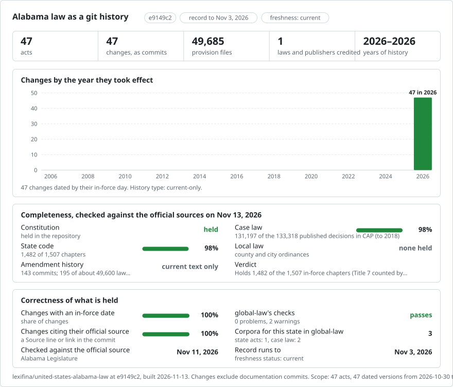

# United States (Alabama): law in git

<picture>
<source media="(prefers-color-scheme: dark)" srcset="data/effort-dark.svg">

</picture>

Part of [lexifina/global-law](https://github.com/lexifina/global-law), one git history for every country's law: this is the law of Alabama, United States, which global-law reads at `united-states/alabama/acts/`.

Current-text snapshots of the Constitution of Alabama (2022 recompilation) and all 46 Code of Alabama title roots, from the [Alabama Legislature](https://alison.legislature.state.al.us/code-of-alabama). Language: English. Global-law path: `united-states/alabama/`.

| Folder | Law | Snapshot versions |
| --- | --- | ---: |
| `constitution/` | Constitution of Alabama (2022 recompilation) | 1 |
| `title-13a/` | Code of Alabama 1975, Title 13A Criminal Code | 1 |
| `title-10a/` | Code of Alabama 1975, Title 10A Alabama Business and Nonprofit Entities Code | 1 |
| `title-35/` | Code of Alabama 1975, Title 35 Property | 1 |
| `title-1/` | Code of Alabama 1975, Title 1 General Provisions | 1 |
| `title-2/` | Code of Alabama 1975, Title 2 Agriculture | 1 |
| `title-3/` | Code of Alabama 1975, Title 3 Animals | 1 |
| `title-4/` | Code of Alabama 1975, Title 4 Aviation | 1 |
| `title-5/` | Code of Alabama 1975, Title 5 Banks and Financial Institutions | 1 |
| `title-6/` | Code of Alabama 1975, Title 6 Civil Practice | 1 |
| `title-7/` | Code of Alabama 1975, Title 7 Commercial Code | 1 |
| `title-8/` | Code of Alabama 1975, Title 8 Commercial Law and Consumer Protection | 1 |
| `title-9/` | Code of Alabama 1975, Title 9 Conservation and Natural Resources | 1 |
| `title-10/` | Code of Alabama 1975, Title 10 Corporations, Partnerships, and Associations | 1 |
| `title-11/` | Code of Alabama 1975, Title 11 Counties and Municipal Corporations | 1 |
| `title-12/` | Code of Alabama 1975, Title 12 Courts | 1 |
| `title-14/` | Code of Alabama 1975, Title 14 Criminal Correctional and Detention Facilities | 1 |
| `title-15/` | Code of Alabama 1975, Title 15 Criminal Procedure | 1 |
| `title-16/` | Code of Alabama 1975, Title 16 Education | 1 |
| `title-17/` | Code of Alabama 1975, Title 17 Elections | 1 |
| `title-18/` | Code of Alabama 1975, Title 18 Eminent Domain | 1 |
| `title-19/` | Code of Alabama 1975, Title 19 Fiduciaries and Trusts | 1 |
| `title-20/` | Code of Alabama 1975, Title 20 Food, Drugs and Cosmetics | 1 |
| `title-21/` | Code of Alabama 1975, Title 21 Handicapped Persons | 1 |
| `title-22/` | Code of Alabama 1975, Title 22 Health, Mental Health, and Environmental Control | 1 |
| `title-23/` | Code of Alabama 1975, Title 23 Highways, Roads, Bridges and Ferries | 1 |
| `title-24/` | Code of Alabama 1975, Title 24 Housing | 1 |
| `title-25/` | Code of Alabama 1975, Title 25 Industrial Relations and Labor | 1 |
| `title-26/` | Code of Alabama 1975, Title 26 Infants and Incompetents | 1 |
| `title-27/` | Code of Alabama 1975, Title 27 Insurance | 1 |
| `title-28/` | Code of Alabama 1975, Title 28 Intoxicating Liquor, Malt Beverages and Wine | 1 |
| `title-29/` | Code of Alabama 1975, Title 29 Legislature | 1 |
| `title-30/` | Code of Alabama 1975, Title 30 Marital and Domestic Relations | 1 |
| `title-31/` | Code of Alabama 1975, Title 31 Military Affairs and Civil Defense | 1 |
| `title-32/` | Code of Alabama 1975, Title 32 Motor Vehicles and Traffic | 1 |
| `title-33/` | Code of Alabama 1975, Title 33 Navigation and Watercourses | 1 |
| `title-34/` | Code of Alabama 1975, Title 34 Professions and Businesses | 1 |
| `title-36/` | Code of Alabama 1975, Title 36 Public Officers and Employees | 1 |
| `title-37/` | Code of Alabama 1975, Title 37 Public Utilities and Public Transportation | 1 |
| `title-38/` | Code of Alabama 1975, Title 38 Public Welfare | 1 |
| `title-39/` | Code of Alabama 1975, Title 39 Public Works | 1 |
| `title-40/` | Code of Alabama 1975, Title 40 Revenue and Taxation | 1 |
| `title-41/` | Code of Alabama 1975, Title 41 State Government | 1 |
| `title-42/` | Code of Alabama 1975, Title 42 United States | 1 |
| `title-43/` | Code of Alabama 1975, Title 43 Wills and Decedents’ Estates | 1 |
| `title-44/` | Code of Alabama 1975, Title 44 Youth Services | 1 |
| `title-45/` | Code of Alabama 1975, Title 45 Local Laws | 1 |

The record has 47 act folders and 49,638 section files. Fourteen labelled correction commits restored 40 omitted current sections. Twenty-six further section files have labelled wording corrections; earlier commits remain in history.

## Dates and limits

All 40 sections omitted from the initial snapshot have since been restored through labelled corrections. The source-heading dates and body-date evidence for those sections are recorded in `data/omission-restorations.tsv`. The correction ranges describe when the record starts, not a claim that legislative commencement occurred that day.

For the first 26 restored sections, the official heading, API and complete body were audited. No commencement or past applicability date for their current wording was identified. Future dates in their bodies are prospective amendment or repeal notes, not commencement dates of the current wording. Their corrections retain the original November 3, 2026 snapshot range, separately from Text-as-of November 5, 2026; this is not a claim that legislative commencement occurred on the snapshot day. Per-file evidence and the precise basis are recorded in `data/omission-restorations.tsv`. The record does not provide a complete dated history.

Act 2025-379, section 2 of official enrolled HB225, commences October 1, 2028. The conflicting 2026 editorial note in section 34-27-35 is documented in the restoration evidence; the later amendment wording is not included early.

A November 11 source audit found 256 section word differences in the published snapshot. The earlier batch corrected 26 plain-text sections; a later batch corrected 46 table sections. The remaining 131 discrepancies include tables, date-bearing text and other cases held for further review; complete source-text coverage is not claimed.

One source image in 45-57A-63.31 is a decorative signature line; no normative image was identified in the reviewed ten titles or the restored sections.

## Sources and licence

Official sources are the Alabama Legislature’s Code, Constitution, act register and enrolled bills. Statute text is public law; see `LICENSE`. This is not an official publication or legal advice.

## Source-text corrections

Twenty-six section files have labelled corrections restoring words present in the Alabama Legislature’s published Code text at the original snapshot and on November 11, 2026. The record still has unresolved table and date-bearing section discrepancies; full word-for-word coverage is not claimed.

## Table-text corrections

46 section files have labelled corrections restoring official table wording and cell structure. The tables use HTML within Markdown. These corrections retain the original title record starts (October 30 or November 3, 2026), separately from the November 11 text check; no source commencement date was identified for their wording. Other source discrepancies and dated history remain unresolved.

## Further source-text corrections

55 section files have further labelled corrections: 53 resolve remaining official-source discrepancies and two restore paragraph separators in earlier corrections. Generic references to applicability, amendments, or relative time were assessed individually; the selected sections give no calendar commencement date for their wording. Original October 30 or November 3, 2026 record starts remain separate from the November 11 text check. Sections with calendar dates, unresolved date cues, or unsupported table spans remain outside this batch; complete source fidelity and dated history are not claimed.

## Further assessed source-text corrections

20 section files restore official source words and table cells after assessment of their date references. Body dates and relative references were assessed individually as reporting deadlines, eligibility thresholds, reference schedules, or future conditional repeals; the selected sections give no calendar commencement date for their wording. Original October 30 or November 3, 2026 record starts remain separate from the November 11 text check. Other sections with unresolved commencement or repeal dates, unassessed date cues, or unsupported table spans remain outside this batch; complete source fidelity and dated history are not claimed.

This batch leaves 111 cases from the audited discrepancy range unresolved, plus 132 previously identified dated source rows. The precise body-date assessments and source response hashes are recorded in `data/assessed-date-corrections.json`.

## Remaining source-text corrections

33 section files restore official source words and table cells after assessment of their date references. Twenty-eight files preserve official repeal notices; five restore substantive wording and seven source tables. The five substantive sections state deadlines, participant cohorts or a future conditional repeal rather than commencement of their complete wording. Undated wording keeps its original record start separately from the November 11 text check. Repeal-only notices use the expressly stated January 1, 2002 repeal date; their correction ranges start at the existing snapshot and supply no earlier substantive text. Other sections with unresolved commencement or repeal dates, unassessed date cues, or unsupported table spans remain outside this batch; complete source fidelity and dated history are not claimed.

This batch leaves 78 cases from the audited discrepancy range unresolved, plus 132 previously identified dated source rows. The precise body-date assessments and source response hashes are recorded in `data/remaining-date-corrections.json`.

## Remaining source-text corrections

7 section files restore official source words and table cells after assessment of their date references. The batch restores 6 source tables, including two tables whose CALS column-start markers require empty preceding cells. Body dates state recurring collection schedules, a rule-adoption deadline, participant-entry cohorts or conviction dates rather than commencement of complete wording. Undated wording keeps its explicitly labelled original retrieval-day record start separately from the November 11 text check. No earlier substantive wording is reconstructed. Other sections with unresolved commencement or repeal dates, unassessed date cues, or unsupported table spans remain outside this batch; complete source fidelity and dated history are not claimed.

This batch leaves 71 cases from the audited discrepancy range unresolved, plus 132 previously identified dated source rows. The precise body-date assessments and source response hashes are recorded in `data/final-depth-corrections.json`.

## Current Title 26 sections with future amendments

Five current sections omitted from the initial Title 26 snapshot are restored. The official Code also publishes Act 2026-488 wording or repeal for January 1, 2027; those future rows are outside this current-text correction. The current rows state no commencement date for their existing wording, so the correction retains the explicitly labelled November 3, 2026 retrieval-day record start. Source dates and hashes are recorded in `data/dated-current-restorations.json`. Other unresolved source-text and historical dating cases remain outside this batch.

## Remaining source-text corrections

4 section files restore official source words and table cells after assessment of their date references. The batch restores 0 source tables, preserving the official cell order. Assessed body dates select service-entry or disability-event cohorts and the May 18, 2017 staffing baseline; they do not date commencement of complete wording. Undated wording keeps its explicitly labelled original retrieval-day record start separately from the November 11 text check. No earlier substantive wording is reconstructed. Other sections with unresolved commencement or repeal dates, unassessed date cues, or unsupported table spans remain outside this batch; complete source fidelity and dated history are not claimed.

This batch leaves 67 cases from the audited discrepancy range unresolved. The separately assessed 96 future-effective rows are outside the current snapshot. The precise body-date assessments and source response hashes are recorded in `data/assessed-depth-corrections.json`.

## Remaining source-text corrections

4 section files restore official source words and table cells after assessment of their date references. The batch restores 3 source tables, preserving the official cell order. Assessed body dates select board-decision cohorts and filing deadlines, ratification of prior spending, and expressly dated salary provisions; the first two do not date commencement of complete wording, while the salary provisions supply their own dates. Two salary sections use their expressly stated January 1, 1984 and August 1, 2000 dates in In-force trailers. Two other sections retain their explicitly labelled original retrieval-day record start separately from the November 13 text check. All Corrects ranges remain limited to the existing snapshot. No earlier substantive wording is reconstructed. Other sections with unresolved commencement or repeal dates, unassessed date cues, or unsupported table spans remain outside this batch; complete source fidelity and dated history are not claimed.

This batch leaves 63 cases from the audited discrepancy range unresolved. The separately assessed 96 future-effective rows are outside the current snapshot. The precise body-date assessments and source response hashes are recorded in `data/reviewed-depth-corrections.json`.

## Pension source-text corrections

2 section files restore official source words and table cells. The batch retains 0 source tables. The House district section is outside this correction because its available official body is incomplete. Dates in two pension sections describe administrative deadlines, recurring schedules and military-service eligibility cohorts rather than commencement of complete wording. Those two corrections retain the explicitly labelled original November 3, 2026 retrieval-day record start separately from the November 13 text check. All correction ranges are limited to the existing snapshot; no earlier substantive wording is reconstructed.

This batch leaves 61 cases in the audited discrepancy range unresolved. The separately assessed 96 future-effective rows remain outside the current snapshot. Complete source fidelity and dated history are not claimed. Per-file date assessments and source response hashes are recorded in `data/depth-1918-revision-corrections.json`.

## Additional source-text corrections

4 section files restore official source words and table structure after individual source-date assessments. The batch retains 1 source tables. Source-dated corrections carry their individually stated dates; undated complete wording retains the explicitly labelled original retrieval-day record start separately from the November 13 text check. All correction ranges remain limited to the existing snapshot; no earlier substantive wording is reconstructed. 57 audited cases remain unresolved, including the incomplete House district body. The separately assessed 96 future-effective rows remain outside the current snapshot. Complete source fidelity and dated history are not claimed. Per-file source-date assessments and response hashes are in `data/depth-1939-corrections.json`.

## Official source histories

`data/source-histories/` contains 48,114 verbatim official history fields associated with existing section files across all 46 Code titles, checked November 13, 2026. Each entry identifies its section, official response URL and SHA-256, and preserves the source effective/supersession fields. These act and former-code citations provide section-level provenance. Citation years are recorded as citations; they are not inferred commencement dates. Source HTML entities, including repeated escaping, remain exactly as supplied. The index is separate from the statute files and dated legal versions. Future-effective rows and rows without matching published section paths are excluded. The existing unresolved wording/date cases and incomplete House district text still require review; complete dated history and current-law fidelity are not claimed.

## Official enacted-instrument register

`data/source-act-register/` records 16,994 enacted-instrument entries from the Alabama Legislature across 29 session years, checked November 13, 2026. It preserves the official act and bill identifiers, titles, enrolled-text links, and supplied effective-date fields. 6,342 act numbers have 25,350 exact citation references to the existing section-history indexes. Only explicit Act/Acts identifiers in year-number form are linked; earlier year-and-number citations remain in the verbatim histories. The separate Code disposition index preserves 1,262 official section/action/effective-date records. These source dates and citations are metadata, separate from the statute snapshots. They do not establish commencement of an entire consolidated section, reconstruct historical wording, or assert that every enacted instrument remains in force. The register includes resolutions and other enacted instruments where listed by the source. Records without source dates retain null fields. Complete dated history and current-law fidelity remain unresolved.

## Official source date candidates

`data/source-date-candidates.json` maps official act-register date fields to exact Act/Acts citations in the source-history indexes for 5,765 section files, checked November 13, 2026. It records 6,879 dated citation candidates from 2,010 source-dated enacted-instrument records. These are provenance and review aids only. They do not date an entire consolidated section, reconstruct historical wording, or change statute text.

## Official section dispositions

`data/source-section-dispositions.json` preserves all 1,262 official Code disposition records, checked November 13, 2026. Exact section identities link these records to 1,180 existing section files; exact session, act and bill identities link every record to enrolled-instrument metadata. Of the linked records, 87 have no explicit year-number Act citation in the corresponding source history. Sixty-one rows have no unique source-history match and retain null section links. The source lists 589 additions, 507 amendments and 166 repeals, with 1,259 supplied dates. These are section-specific provenance records, including future dates; they do not reconstruct earlier wording or establish commencement of a complete consolidated section. Complete legal history and current-law fidelity remain unresolved.

## Held section source audit

`data/held-section-source-audit.json` identifies 49 unresolved section cases from the earlier source review, checked again against the Alabama Legislature on November 13, 2026. It records each official response, source row hash and supplied date fields alongside the unchanged published file hash. The eight separate Title 40 corrections held for a correction or rework job are outside this index. This audit changes no statute wording or dates and does not resolve the held cases.

## Official source image inventory

An all-act ALISON source-media audit checked the Constitution and all 46 Code title roots on November 13, 2026. The audit examined 60204 official source rows and found 1 row with source media markup. The inventory is recorded in `data/source-image-inventory.json`. It changes no statute text and does not resolve the remaining wording/date holds.
